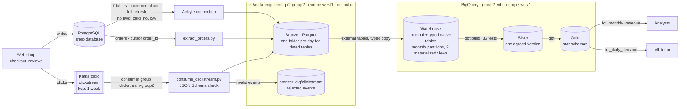

# Architecture

## Context

Albert's Marketplace is a European marketplace for beauty products. Today, one PostgreSQL database serves both the web shop and the analysts, so reports slow down checkout and two reports give two different revenue figures. The platform must serve two users: analysts, who need one agreed revenue figure, and the ML team, who need units sold per product, per country, per day. Daily freshness is enough for both; nothing needs real-time data. Two constraints matter: the shop's database must not carry analytical load, and passwords and card numbers must never leave it.

## Architecture (after L10)

Solid lines exist today. Dotted lines are planned.

Three paths write into bronze without a person: see [ADR-0003](adr/0003-ingestion-modes.md) for which mode each source uses, and [ingestion-failure-modes.md](ingestion-failure-modes.md) for what each one loses or duplicates. The first load, in L02, was done once by hand with [`ingestion/load_bronze_export.py`](../ingestion/load_bronze_export.py).

Bronze is read by BigQuery in the same region. Fact tables are partitioned by month, and two materialized views precompute daily demand per product and per range. Measures and choices are in [warehouse-tuning.md](warehouse-tuning.md); the pricing model is in [ADR-0004](adr/0004-warehouse-pricing.md). Silver and gold are built by dbt: see [dbt-models.md](dbt-models.md). Demand per country is in `fct_daily_demand`.

## Layers

| Layer | What lands here | What it guarantees | Who reads it |
|---|---|---|---|
| Bronze | The 7 tables from the database, `orders` from our extractor, and the clickstream, unchanged. Duplicates are kept. `pwd`, `card_no` and `cvv` never arrive. Events that fail the schema go to `_dlq/`. | Nothing that arrived is lost. | Data engineers only, to debug and rebuild silver. Today every member of the shared project can read it: see [infra/iam.md](../infra/iam.md). |
| Silver | Cleaned, typed tables: one row per real order, duplicates removed. | One agreed version of each fact. | The models that build gold. |
| Gold | Star schemas for named questions: `fct_daily_demand`, `dim_product`, `dim_country`, `dim_date`. | Each table answers a named question, at a declared grain. | Analysts and the ML team. |

## Decisions

| ADR | Decision | Status |
|---|---|---|
| [0001](adr/0001-target-architecture.md) | Adopt a lakehouse with bronze, silver and gold layers | Proposed |
| [0002](adr/0002-bronze-layout.md) | Bronze as Parquet (Snappy), partitioned by day | Proposed |
| [0003](adr/0003-ingestion-modes.md) | Stream the clickstream, batch the database, no change data capture yet | Proposed |
| [0004](adr/0004-warehouse-pricing.md) | BigQuery on-demand pricing with a 10 MiB billing cap | Proposed |

## Change log

| Lesson | What changed |
|---|---|
| L01 | First version: context, target diagram, layer guarantees |
| L02 | The diagram shows what exists: the bucket, its region, its layout, who can read it, and how bronze was filled |
| L03 | Three paths into bronze: Airbyte, the orders extractor, the clickstream consumer; dead letter queue |
| L04 | BigQuery warehouse: typed native tables, monthly partitions, clustering, two materialized views, billing cap |
| L05 | Silver and gold built with dbt (group2_silver, group2_gold): 14 models, 35 tests, revenue reconciled to the cent, source freshness check |
| L06 | Dockerfiles for the ingestion jobs and dbt: see `docs/packaging.md` |
| L07 | Airflow DAG `marketplace_daily_group2`: extract, load, dbt build, freshness, every day. See `docs/orchestration.md` |
| L08 | Bucket and datasets declared in Terraform (`infra/`), imported with no change, remote state, `terraform plan` in CI. See `docs/infrastructure-as-code.md` |
| L09 | Labels on every resource (Terraform), budget in code (off: no billing rights), daily cost alert in Airflow, partitioning gain in USD. See `docs/finops.md` |
| L10 | PII redaction in dbt (reviews masked, author dropped), data classification labels, gold-only readers in Terraform, Airflow Fernet key. See `docs/security.md` |
