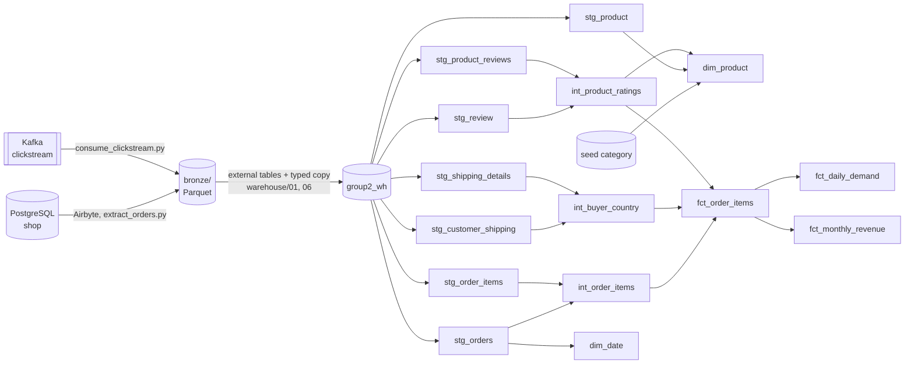

# Lineage

Where each gold column comes from. dbt also draws this graph: `cd dbt && dbt docs generate && dbt docs serve`.

| Gold column | From | Through |
|---|---|---|
| `fct_monthly_revenue.revenue` | `order_items.qty`, `price_at_purchase` | `stg_order_items` → `int_order_items` → `fct_order_items.line_revenue` → sum per month |
| `fct_daily_demand.units` | `order_items.qty` | same path, summed per product, country, day |
| `fct_daily_demand.country` | `shipping_details.country` | `stg_shipping_details` → `int_buyer_country` (default address) → `fct_order_items` |
| `*.order_date` | `orders.order_date` (the `dt` folder of bronze) | `stg_orders` → `int_order_items` |
| `dim_product.category_name` | seed `category.csv` | copied from the source table `category` |
| `dim_product.avg_rating`, `n_reviews` | `review.rating` | `stg_review` + `stg_product_reviews` → `int_product_ratings` |

Silver is views in `group2_silver`, gold is tables in `group2_gold` (ADR-0005).
The clickstream is in bronze only; it is not modelled yet.
